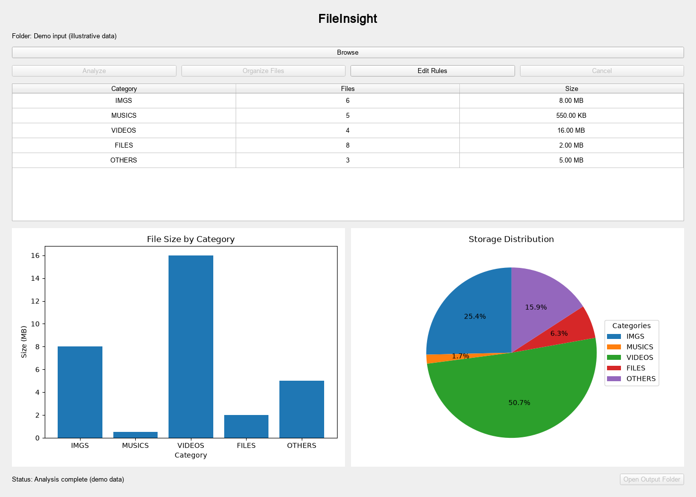
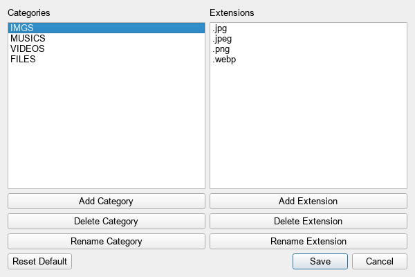
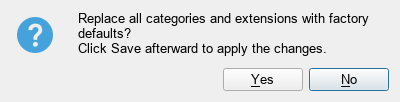

# FileInsight

A Python desktop application for analyzing folder contents and copying files into customizable categories. Built with PySide6 and Matplotlib as a learning and portfolio project.

## Preview



The overview uses illustrative statistics, rendered from the current application code. It does not show a scan of personal files. Screenshot fonts and window decorations may differ from the normal desktop environment.

## Features

- Recursively analyze files and display per-category file counts and sizes.
- Visualize storage usage in a table, bar chart, and pie chart.
- Add, delete, and rename categories and file extensions.
- Validate category names and prevent duplicate extension assignments in the editor.
- Save rules to JSON, discard edits with Cancel, or restore factory rules after confirmation.
- Copy files in a background worker with progress reporting and cooperative cancellation.
- Preserve existing output folders by creating numbered alternatives.
- Rename colliding filenames within an output category instead of overwriting them.
- Open the most recently completed output folder in the system file manager.
- Remember the last selected folder and window geometry.
- Request cancellation and wait for thread cleanup when closing during organization.

## Quick start (Windows CMD)

Development has used Python 3.12.9 on Windows. Dependencies are pinned in `requirements.txt`; installation in a fresh environment has not been revalidated for this documentation update.

```bat
git clone https://github.com/JaxUnicoder/FileInsight.git
cd FileInsight
py -3.12 -m venv .venv
.venv\Scripts\activate
python -m pip install -r requirements.txt
python gui.py
```

For an existing checkout:

```bat
cd /d D:\MyProjects\FileInsight
.venv\Scripts\activate
python gui.py
```

Run from the project directory: `settings.json` is currently resolved relative to the working directory. The supported GUI entry point is `gui.py`; the older `main.py` command-line entry point still needs its rules argument updated.

## Usage

1. Click **Browse** and select a folder.
2. Click **Analyze** to inspect counts and storage distribution.
3. Open **Edit Rules** to customize categories and extensions.
4. Click **Save** to persist and apply changes, or **Cancel** to discard them.
5. Click **Organize Files** to copy files into categorized output folders.
6. Click **Open Output Folder** after successful completion.

### Rules editor



- Select a category to see its extensions.
- Extensions are normalized to lowercase and receive a leading dot when omitted.
- Each extension can belong to one category in editor-created rules.
- Renaming a category or extension changes classification rules, not existing files on disk.
- Unmatched files go to `OTHERS`, which is reserved as the fallback category.
- Saving changed rules hides previous statistics; click **Analyze** to refresh them.

### Restore defaults



**Reset Default** asks for confirmation and replaces the editor's rule copy with `DEFAULT_RULES`. It does not immediately write JSON. Click **Save** to apply the reset or **Cancel** to retain the previous rules. Window geometry and other preferences are unaffected.

### Output behavior

For a source folder named `Photos`, output is created beside the source:

```text
Photos/
Photos_organized/
Photos_organized (1)/
Photos_organized (2)/
```

The GUI asks before proceeding when the base output path already exists. A new run uses the first available numbered directory; deleted numbers may be reused. Files from nested source folders are grouped by category rather than preserving the source directory tree. Filename collisions are handled with suffixes such as `image_1.jpg`.

Source files are copied, not moved. This is filename collision handling, not content deduplication.

### Cancellation and closing

Cancel is checked between file copies. The current file copy and the initial file enumeration must finish before cancellation is observed. Files already copied remain in the output directory; cancellation does not roll back results. Closing during organization asks whether to cancel and exit, then waits for the worker thread to finish cleanup.

## Project structure

| File | Responsibility |
| --- | --- |
| `gui.py` | Main window, charts, rules dialog, worker and thread coordination |
| `organizer.py` | Classification, statistics, output creation and copying |
| `default_rules.py` | Factory classification template |
| `settings.py` | JSON loading and saving |
| `settings.json` | User rules, last folder and window state |
| `file_stats.py` | File-size formatting and console statistics |
| `visualizer.py` | Earlier standalone chart functions |
| `main.py` | Earlier command-line entry point; currently needs maintenance |

The editor and worker receive deep copies of rules so editing does not mutate the factory template or an active task's rules.

## Current limitations

- Analysis runs on the GUI thread and can temporarily block the interface for large folders.
- JSON loading has no recovery for malformed settings; saving directly overwrites the file rather than using atomic replacement.
- Rules manually edited in JSON do not receive the editor's full validation on load.
- Only the final suffix is classified (`.tar.gz` is matched as `.gz`).
- No SHA256 content deduplication, rollback, or resumable copying is implemented.
- Qt provides cross-platform APIs, but this project has not been fully tested on Linux or macOS.
- The project is not yet packaged as an installer or standalone executable.

## Development status

This is an evolving portfolio project. Targeted checks have covered classification, copying, output numbering, progress callbacks, cancellation checks, and rules-editor operations. Those checks do not establish complete end-to-end or cross-platform coverage. The documentation update generated real Qt widget screenshots using isolated demo settings; it did not modify source files or user settings.
